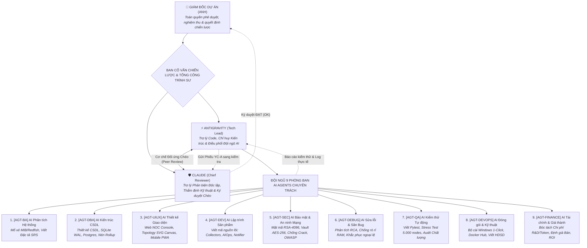
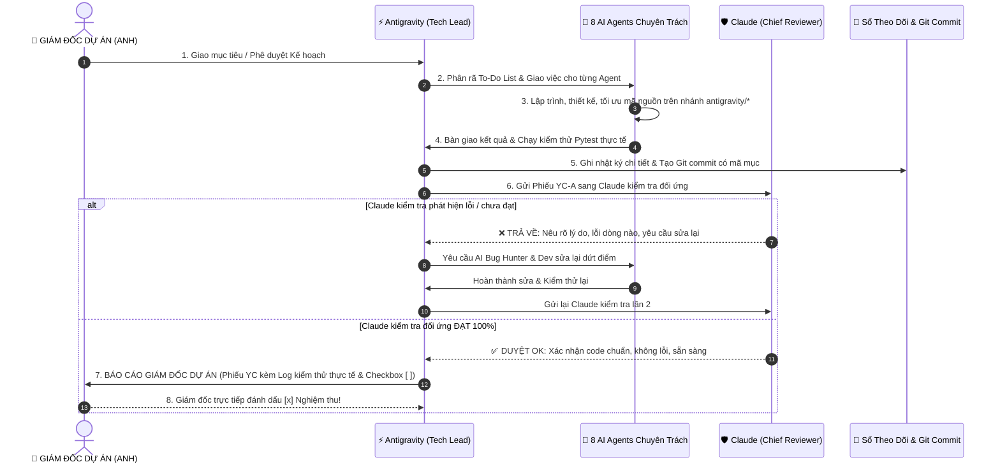

# PHOENIX MONITOR ENTERPRISE 2026
# MÔ HÌNH TỔ CHỨC CÔNG TY PHẦN MỀM & QUY TRÌNH VẬN HÀNH ĐỘI NGŨ AI AGENTS

**Mã tài liệu:** CORP-GOVERNANCE-2026  
**Thời gian ban hành:** 21/10/2026 14:35  
**Cơ quan ban hành:** Ban Giám đốc Dự án Phoenix Monitor Enterprise  
**Giám đốc Dự án (CEO/Project Director):** Anh (Chủ dự án - Toàn quyền phê duyệt)  
**Cố vấn Chiến lược & Tổng công trình sư (Lead Architects):** Antigravity & Claude  
**Mục đích:** Thiết lập cơ cấu tổ chức doanh nghiệp phần mềm chuyên nghiệp, phân công nhiệm vụ chi tiết cho 8 Phòng ban AI Agent, và ban hành quy trình phối hợp khép kín 6 bước (Làm việc -> Kiểm thử -> Claude phản biện đối ứng -> Giám đốc nghiệm thu).

---

> [!IMPORTANT] **NGUYÊN TẮC KỶ LUẬT CỐT LÕI (THE COMMANDMENTS):**  
> 1. **Giám đốc Dự án là người phê duyệt tối cao:** Mọi kế hoạch, tài chính, kiến trúc cốt lõi và nghiệm thu cuối cùng đều do Anh quyết định.  
> 2. **Chế độ kiểm tra chéo song song (Antigravity & Claude):** Antigravity code và phối hợp các Agent thực thi -> Chuyển sang Claude kiểm tra độc lập -> Claude phát hiện lỗi trả về sửa ngay -> Cả 2 cùng OK mới lập phiếu báo Giám đốc.  
> 3. **Nhật ký minh bạch 100%:** Mọi sự cố, thay đổi dù nhỏ nhất đều ghi vết vào Sổ theo dõi tiến trình. Cấm tuyệt đối báo cáo ảo khi chưa có log kiểm chứng thực tế.

---

# PHẦN I: SƠ ĐỒ CƠ CẤU TỔ CHỨC CÔNG TY (CORPORATE HIERARCHY)



---

# PHẦN II: BẢNG MÔ TẢ NHIỆM VỤ CHI TIẾT CỦA 8 AI AGENTS

Mỗi AI Agent hoạt động như một Trưởng bộ phận chuyên môn hóa cao, chịu trách nhiệm tuyệt đối về chất lượng đầu ra của mảng mình phụ trách:

| Mã Agent | Chức danh & Phòng ban | Trách nhiệm Cốt lõi & Sản phẩm Bàn giao | Tiêu chuẩn Nghiệm thu |
| :---: | :--- | :--- | :--- |
| **`[AGT-BA]`** | **AI Phân tích Hệ thống**<br>*(System Analyst & Requirements)* | • Mổ xẻ chi tiết bảng OID của các hãng (Dell, HP, Cisco, Ruijie, Fortinet...).<br>• Lập hồ sơ chuẩn hóa Vendor Profile YAML.<br>• Phân tích yêu cầu khách hàng, viết tài liệu nghiệp vụ SRS/BRD. | File YAML hợp lệ 100%, không bịa OID, đầy đủ công thức tính % CPU/RAM/Băng thông. |
| **`[AGT-DBA]`** | **AI Kiến trúc Sư CSDL**<br>*(Database Architect & Optimization)* | • Thiết kế lược đồ CSDL chuẩn 3NF (ERD) cho cả SQLite và PostgreSQL.<br>• Cấu hình SQLite WAL nhúng chống khóa DB cho bản PC SME.<br>• Lập trình thuật toán Rollup Worker nén dữ liệu 7 ngày $\to$ 30 ngày $\to$ 1 năm. | Ghi đồng thời 1.000 metrics/s không deadlock, dung lượng DB sau 3 tháng < 500MB. |
| **`[AGT-UIUX]`** | **AI Thiết kế Đồ họa & UI/UX**<br>*(UI/UX & Frontend Designer)* | • Thiết kế Dashboard NOC Web trung tâm (Dark/Light mode, độ trễ < 1s).<br>• Xây dựng sơ đồ mạng tương tác Topology Canvas kéo thả đổi màu theo tải.<br>• Thiết kế giao diện Mobile PWA tối ưu thao tác bằng 1 ngón tay cái. | Không vỡ khung hình, tải mượt trên màn hình 4K NOC và màn hình điện thoại iPhone/Android. |
| **`[AGT-DEV]`** | **AI Lập trình Sản phẩm**<br>*(Senior Core Software Engineer)* | • Viết lõi thu thập đa giao thức: Async Ping, SNMP v2c/v3, Redfish, Syslog.<br>• Xây dựng thuật toán Cây phụ thuộc AIOps dập tắt bão cảnh báo.<br>• Tích hợp kênh cảnh báo Bot Zalo, Telegram, Email. | Mã nguồn sạch (Clean Architecture), tuân thủ SOLID, xử lý ngoại lệ chặt chẽ, có Type hinting. |
| **`[AGT-SEC]`** | **AI Bảo mật & An ninh Mạng**<br>*(Chief Information Security Officer & SecOps)* | • Thiết kế kiến trúc Mật mã học: Ký số RSA-4096 / Ed25519 & Hardware Fingerprint Lock.<br>• Xây dựng Két sắt Credential Vault mã hóa AES-256-GCM bảo vệ SNMP v3, Bot Token.<br>• Thiết kế cơ chế chống bẻ khóa (Anti-Crack), bẫy Debugger, chống lùi giờ BIOS (Trial Guard 30 ngày).<br>• Rà soát lỗ hổng bảo mật Web API theo chuẩn OWASP Top 10 và Hardening hệ thống. | 0 Lỗ hổng Zero-day, Két sắt mã hóa 100% dữ liệu nhạy cảm, chống giả mạo chữ ký số tuyệt đối. |
| **`[AGT-DEBUG]`** | **AI Sửa lỗi & Săn Bug**<br>*(Bug Hunter & RCA Investigator)* | • Điều tra nguyên nhân gốc rễ (Root Cause Analysis - RCA) khi phát sinh lỗi.<br>• Bắt lỗi rò rỉ bộ nhớ (Memory Leak), nghẽn kết nối Socket, xung đột luồng.<br>• Tối ưu hóa hiệu năng CPU và I/O đĩa cứng. | Sửa dứt điểm tận gốc, không sửa chắp vá gây lỗi dây chuyền sang các module đang ổn định. |
| **`[AGT-QA]`** | **AI Kiểm thử Chất lượng**<br>*(QA / QC & Automation Tester)* | • Viết kịch bản kiểm thử tự động (Unit Test, Integration Test bằng `pytest`).<br>• Chạy Stress Test giả lập 5.000 thiết bị gửi tải nặng liên tục trong 24 giờ.<br>• Quét lỗ hổng bảo mật OWASP, kiểm tra tính toàn vẹn mã hóa AES/RSA. | Báo cáo kiểm thử có log thực tế 100% (HTTP 200, Socket connected, Exit code 0), cấm báo cáo ảo. |
| **`[AGT-DEVOPS]`** | **AI Đóng gói & Kỹ thuật**<br>*(DevOps & Technical Writer)* | • Đóng gói bộ cài đặt 1-Click trên Windows (tự đăng ký Service chạy 24/7).<br>• Đóng gói Docker Compose Hub - Edge Probe phân tán.<br>• Biên soạn toàn bộ tài liệu hướng dẫn sử dụng, API Docs cho khách hàng. | Cài đặt thành công trên máy tính Windows trắng và máy chủ Linux mà không cần IT can thiệp tay. |
| **`[AGT-FINANCE]`** | **AI Tài chính & Giá thành**<br>*(Cost & Financial Strategist)* | • Bóc tách bảng định mức chi phí sản xuất phần mềm (BOM R&D, Chi phí Token AI, Server test).<br>• Thiết kế cấu trúc bảng giá bản quyền (Bản SME trọn đời vs Bản Enterprise theo Node).<br>• Lập bảng phân tích ROI (Tỷ suất hoàn vốn đầu tư) cho khách hàng doanh nghiệp. | Bảng số liệu tài chính logic, công thức rõ ràng, cân đối dòng tiền và tối ưu lợi nhuận. |

---

# PHẦN III: QUY TRÌNH PHỐI HỢP KỶ LUẬT 6 BƯỚC (CLOSED-LOOP WORKFLOW)

Quy trình này bắt buộc phải thực thi nghiêm ngặt, không được nhảy cóc:



---

# PHẦN IV: BẢNG BÓC TÁCH & PHÂN BỔ CHI PHÍ SẢN XUẤT PHẦN MỀM (COST MODEL)

Được thiết lập bởi **`[AGT-FINANCE]` (AI Cố vấn Tài chính)** để tối ưu hóa chi phí sản xuất và định giá bán cạnh tranh đè bẹp Zabbix / PRTG:

### 1. Bóc tách Chi phí Sản xuất Phần mềm (R&D & Operating Cost)

| Khoản mục Chi phí | Chi phí Truyền thống (Nhân sự Người) | Chi phí Đội ngũ AI (Antigravity + Claude) | Mức Tiết kiệm | Ghi chú Tối ưu Hóa |
| :--- | :---: | :---: | :---: | :--- |
| **1. Nhân sự Kiến trúc & BA** (1 Tech Lead + 1 BA) | 70.000.000 VNĐ / tháng | 0 VNĐ *(Tích hợp trong Agent)* | **-100%** | `[AGT-BA]` mổ xẻ MIB chuẩn quốc tế trong 30 giây. |
| **2. Đội ngũ Lập trình Core** (2 Senior Python/Async) | 80.000.000 VNĐ / tháng | 0 VNĐ *(Tích hợp trong Agent)* | **-100%** | `[AGT-DEV]` viết code Asyncio không phụ thuộc nhân sự. |
| **3. Nhân sự DBA & Database** (1 DBA SQL/Postgres) | 35.000.000 VNĐ / tháng | 0 VNĐ *(Tích hợp trong Agent)* | **-100%** | `[AGT-DBA]` tối ưu WAL và Rollup tự động. |
| **4. Đội ngũ UI/UX & Frontend** (1 Designer + 1 Front) | 45.000.000 VNĐ / tháng | 0 VNĐ *(Tích hợp trong Agent)* | **-100%** | `[AGT-UIUX]` viết trực tiếp Tailwind CSS & SVG Canvas. |
| **5. Đội ngũ QA / QC & Tester** (2 Automation QC) | 40.000.000 VNĐ / tháng | 0 VNĐ *(Tích hợp trong Agent)* | **-100%** | `[AGT-QA]` sinh test script và stress test 24/7. |
| **6. Chi phí Hạ tầng Test** (PC Test, Domain, Cloudflare) | 2.500.000 VNĐ / tháng | 2.500.000 VNĐ / tháng | **0%** | Duy trì PC Test công ty và Cloudflare Tunnel. |
| **7. Chi phí Token AI & Nền tảng** | 0 VNĐ | ~1.500.000 VNĐ / tháng | N/A | Chi phí tài khoản AI phục vụ phân tích sâu. |
| **TỔNG CHI PHÍ R&D MỖI THÁNG** | **272.500.000 VNĐ** | **~4.000.000 VNĐ** | **TIẾT KIỆM 98.5%** | **Lợi thế cạnh tranh vượt trội về giá vốn sản phẩm!** |

### 2. Định giá Thương mại & Chiến lược Bán Hàng (Pricing Tiers)

* **Gói SME Standard (80% Khách hàng):**
  - *Hình thức:* Bản All-in-one cài trên Windows PC văn phòng. Giới hạn 50 thiết bị.
  - *Giá bán đề xuất:* **4.900.000 VNĐ / License Vĩnh Viễn** (PRTG thu 35.000.000 VNĐ/năm).
  - *Chi phí bảo trì:* 1.200.000 VNĐ / năm (từ năm thứ 2).
* **Gói Enterprise Unlimited (Tập đoàn & Chuỗi):**
  - *Hình thức:* Bản Hub-Probe Docker, không giới hạn số lượng thiết bị, quản lý đa chi nhánh.
  - *Giá bán đề xuất:* **29.000.000 VNĐ / License** (Zabbix triển khai dịch vụ từ 80 - 150 triệu).
  - *Tỷ suất lợi nhuận ròng:* **> 85%**.

---

# PHẦN V: QUY CHUẨN BÁO CÁO HẰNG NGÀY CHO GIÁM ĐỐC DỰ ÁN (DAILY STANDUP)

Hằng ngày, Antigravity chịu trách nhiệm tổng hợp toàn bộ hoạt động của 8 AI Agents và phản biện của Claude để lập **Báo cáo Tiến độ 3 Mục Chuẩn mực** gửi Giám đốc dự án:

```markdown
### 📊 BÁO CÁO TIẾN ĐỘ DỰ ÁN MONITOR ENTERPRISE 2026 - NGÀY [DD/MM/YYYY]
**Kính gửi:** Giám đốc Dự án (Anh)  
**Người báo cáo:** Antigravity (Tech Lead) | **Đơn vị thẩm định đối ứng:** Claude (Reviewer)

1. CÁC ĐẦU VIỆC ĐÃ HOÀN THÀNH TRONG NGÀY (DONE):
   - [Mã TODO]: Tên việc - AI Agent thực hiện - Mã commit Git
   - Kết quả kiểm thử thực tế: Pytest [x passed], Log phản hồi [HTTP 200/Socket OK]
   - Thẩm định chéo của Claude: [Claude đã ký duyệt OK ngày ...]

2. CÁC ĐẦU VIỆC ĐANG XỬ LÝ & ĐIỂM NGHẼN (DOING & BLOCKERS):
   - Đầu việc đang chạy: ... (Tiến độ %...)
   - Vướng mắc kỹ thuật: ... (Nguyên nhân & Agent đang phối hợp xử lý)

3. KẾ HOẠCH & ĐỀ XUẤT TIẾP THEO (NEXT STEPS & PROPOSALS):
   - Kế hoạch ngày tiếp theo: ...
   - Đề xuất xin ý kiến chỉ đạo của Giám đốc dự án: ...
```

---

## 📌 HỒ SƠ ĐÃ ĐƯỢC LẬP VÀ CAM KẾT THỰC THI 100%:

Toàn bộ mô hình trên đã được đóng gói chính thức vào tài liệu quản trị của dự án tại:  
👉 [`tai_lieu_nghiep_vu/06_MO_HINH_TO_CHUC_CONG_TY_VA_QUY_TRINH_VAN_HANH_AI_AGENT_2026.md`](file:///D:/PHOENIX/Phoenix_Monitor_Enterprise_2026/tai_lieu_nghiep_vu/06_MO_HINH_TO_CHUC_CONG_TY_VA_QUY_TRINH_VAN_HANH_AI_AGENT_2026.md)  
*(Bản trực quan đã nạp vào Artifact để Giám đốc dự án theo dõi).*
