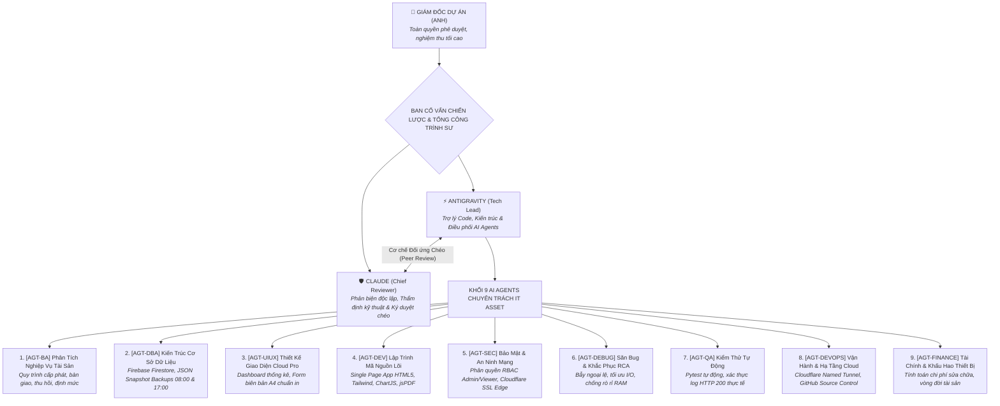

# HỆ THỐNG QUẢN LÝ THIẾT BỊ CNTT - PHOENIX GOLF RESORT
# QUY CHUẨN VẬN HÀNH ĐỘI NGŨ 9 AI AGENTS CHUYÊN TRÁCH 2026

**Mã tài liệu:** PHOENIX-ASSET-GOVERNANCE-2026  
**Dự án:** Quản Lý Thiết Bị CNTT (IT Asset Management - Cloud Pro Edition)  
**Thời gian áp dụng:** 21/10/2026  
**Chủ dự án / Giám đốc:** Anh (Toàn quyền nghiệm thu & phê duyệt tối cao)  
**Lead Architects & Trợ lý cấp cao:** Antigravity (Tech Lead) & Claude (Chief Reviewer)  

---

## 🏛️ I. SƠ ĐỒ CƠ CẤU TỔ CHỨC 3 TẦNG

---

## 📋 II. BẢNG PHÂN CÔNG NHIỆM VỤ 9 AI AGENTS

| Mã Agent | Phòng Ban Chuyên Trách | Nhiệm Vụ Cụ Thể Trong Dự Án Quản Lý Thiết Bị | Tiêu Chí Đo Lường (KPIs) |
| :--- | :--- | :--- | :--- |
| **`[AGT-BA]`** | **Phân Tích Nghiệp Vụ** | Chuẩn hóa quy trình: Bàn giao thiết bị, Thu hồi về kho, Biên bản kiểm tra kỹ thuật, Quản lý thẻ tài sản. | Biểu mẫu chuẩn khổ A4, đầy đủ chữ ký bàn giao theo luật kế toán. |
| **`[AGT-DBA]`** | **Quản Trị Cơ Sở Dữ Liệu** | Quản lý đồng bộ Realtime Google Firebase Firestore, tự động hóa đóng gói sao lưu JSON định kỳ 2 ca/ngày. | 100% dữ liệu không thất thoát, phục hồi dữ liệu (Restore) thành công trong 5 giây. |
| **`[AGT-UIUX]`** | **Thiết Kế Giao Diện** | Tối ưu trải nghiệm Single Page App, hiển thị sắc nét trên cả PC, Tablet và Mobile, tối ưu lệnh in trực tiếp. | Giao diện hiện đại, trực quan, tốc độ tải tức thì dưới 1 giây. |
| **`[AGT-DEV]`** | **Lập Trình Lõi Ứng Dụng** | Phát triển các module tìm kiếm thông minh, lọc nâng cao theo phòng ban/khu vực/trạng thái, xuất báo cáo PDF/Excel. | Mã nguồn sạch, không lỗi console, chạy độc lập không phụ thuộc backend cồng kềnh. |
| **`[AGT-SEC]`** | **An Ninh Mạng & Bảo Mật** | Cấu hình Cloudflare Zero Trust, phân quyền Admin (toàn quyền) và Viewer (chỉ xem), bảo vệ thông tin IP/Serial. | 100% truy cập qua HTTPS mã hóa SSL, chống truy cập trái phép. |
| **`[AGT-DEBUG]`** | **Săn Bug & Điều Tra RCA** | Khắc phục triệt để các lỗi xung đột dữ liệu, lỗi hiển thị bảng kê khi dữ liệu lớn, kiểm soát cache trình duyệt. | Sửa tận gốc nguyên nhân, không phát sinh lỗi dây chuyền. |
| **`[AGT-QA]`** | **Kiểm Thử Tự Động** | Viết kịch bản kiểm thử API, kiểm tra tính toàn vẹn của tệp JSON sao lưu, đo lường phản hồi HTTP 200. | 100% báo cáo có log thực tế, tuyệt đối cấm báo cáo ảo. |
| **`[AGT-DEVOPS]`** | **Đóng Gói & Hạ Tầng** | Duy trì tên miền `https://thietbi.monitorphoenix.io.vn`, đồng bộ GitHub repo `phoenix-it-asset-management`. | Tên miền online 24/7, tự động kết nối qua Cloudflare Edge. |
| **`[AGT-FINANCE]`** | **Tài Chính & Khấu Hao** | Thống kê tổng nguyên giá tài sản CNTT, theo dõi chi phí sửa chữa thay thế linh kiện lũy kế từng máy. | Báo cáo chi phí minh bạch, chính xác từng đồng VNĐ. |

---

## ⚡ III. QUY TRÌNH PHỐI HỢP KỶ LUẬT 6 BƯỚC (CLOSED-LOOP)
1. **Bước 1:** Giám đốc Dự án (Anh) giao mục tiêu hoặc phê duyệt đầu việc.
2. **Bước 2:** Antigravity (Tech Lead) phân rã công việc cho 9 AI Agents.
3. **Bước 3:** Các AI Agent thực thi, lập trình và kiểm tra nội bộ.
4. **Bước 4:** Kiểm thử thực tế bằng log thật (HTTP 200, socket phản hồi, exit code 0).
5. **Bước 5:** Claude phản biện độc lập và ký duyệt chéo (Peer Review).
6. **Bước 6:** Báo cáo chính thức lên Giám đốc dự án nghiệm thu.
